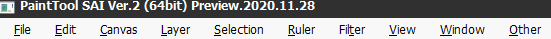
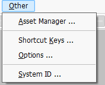
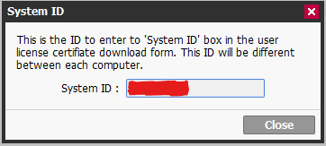

# Paint Tool SAI Crack v2
PaintTool SAI Software Crack (Ver.1 / Ver.2)

**Language:** English | [中文](README.zh-CN.md)

---

If you want to download the latest software package, please go to the official website:

https://www.systemax.jp/en/sai/devdept.html

## Supported packages

| Package | Program | Notes |
|---|---|---|
| `sai2-20241123-32bit-en` / `64bit` | `sai2.exe` | Old SAI2 — works with N patch + license |
| `sai2-20260702b-32bit-en` / `64bit` | `sai2.exe` | **New SAI2** — also re-encrypts internal RSA blob |
| `sai-1.2.5-ful-en.exe` / `sai-1.2.6-Beta.3-ful-en.exe` | `sai.exe` | SAI1 — patch N + re-encrypt SEV0 blob |

## Requirements

- **Python** — https://www.python.org/downloads  
  - Prefer **Python 3** → use `saicrack_py3.py`  
  - Python 2 → use `saicrack_py2.py`  
  - `saicrack_v2.py` is the same v2 logic (alias)
- Download the SAI zip / installer for your PC (**64-bit recommended** on 64-bit Windows)

## Instructions (SAI2)

### 1st: Put the script and `sai2.exe` in the same directory

Copy `saicrack_py3.py` next to `sai2.exe` (after extracting the official zip).

### 2nd: Run the cracker

Open **CMD** or **PowerShell** in that folder, then run:

```bat
python saicrack_py3.py
```

You will be prompted to enter the **System ID**.

Tips:

- Right click empty space in the folder → **Open in Terminal** / **Open CMD**
- Or: `cd /d "D:\path\to\sai2"` then run the command above

### 3rd: Open SAI2 and get System ID

Open SAI2 → **Other** → **System ID ...**

This opens a pop-up with the System ID (8 hex characters).

Help:







### 4th: Enter the System ID

Paste the System ID shown in SAI2 into the console, then press **Enter**.

- Length must be **8**
- Characters: `0-9` `a-f` `A-F` only  
- Do **not** add `0x` or spaces

### 5th: Close SAI2, then type OK

Fully exit SAI2 (make sure `sai2.exe` is not running).  
In the console, type:

```text
OK
```

Then press **Enter**.

### 6th: Finish

When you see **Crack success!**, press Enter to close the script if prompted.

Generated / modified files:

| File | Description |
|---|---|
| `license.slc` | 128-byte license for this System ID |
| `sai-crack.slc` | Same license (extra name for SAI1 `sai-*.slc` search) |
| `sai2.exe.<timestamp>.bak` | Backup of the original EXE before patch |

Restart SAI2. Done.

## Instructions (SAI1)

1. Extract `sai.exe` from `sai-*-ful-en.exe` (the installer contains zip data after the first `PK\x03\x04` signature).
2. Put `saicrack_py3.py` and `sai.exe` in the same directory.
3. Run `python saicrack_py3.py`, enter System ID, close SAI, type `OK`.
4. Use the generated `license.slc` / `sai-crack.slc` next to `sai.exe`.

Example extract (Python):

```bat
python -c "from pathlib import Path; import zipfile; p=Path('sai-1.2.5-ful-en.exe'); d=p.read_bytes(); i=d.find(b'PK\x03\x04'); zipfile.ZipFile(__import__('io').BytesIO(d[i:])).extractall('sai1_extracted'); print('ok')"
```

## What v2 does (short)

1. Builds `license.slc` for your System ID using a known RSA private exponent under replacement modulus **N'**
2. Replaces the public modulus **N → N'** inside the EXE
3. Re-encrypts internal RSA-wrapped data that still depends on old **N** (required for **new SAI2** and **SAI1**)

Old v1 scripts only replaced **N**. That is **not enough** for `sai2-20260702b`.

## Restore backup

```bat
copy /y sai2.exe.***********.bak sai2.exe
```

## Script files

| File | Use |
|---|---|
| `saicrack_py3.py` | **Recommended** (Python 3) |
| `saicrack_py2.py` | Python 2 / same v2 logic |
| `saicrack_v2.py` | Alias of v2 |

Version: **2.0.0**

## ATTENTION NOTICE

www.painttoolsai.cn is an unauthorized seller of SYSTEMAX products. SYSTEMAX has never authorized anyone to sell their products.

Unauthorized sellers buy official licenses and resell one license cheaply to multiple customers. This violates the license agreement.

Illegally distributed licenses may be revoked when found.

Please do not buy from unauthorized sellers.

## Notice

It is recommended to download SAI from:

https://www.systemax.jp/en/sai/devdept.html

---

[中文说明 / Chinese README](README.zh-CN.md)
